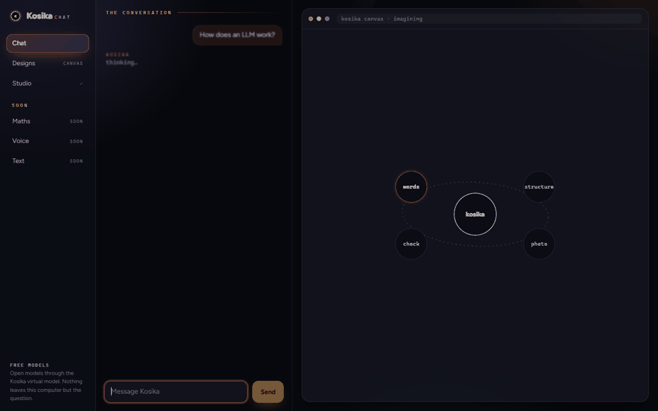
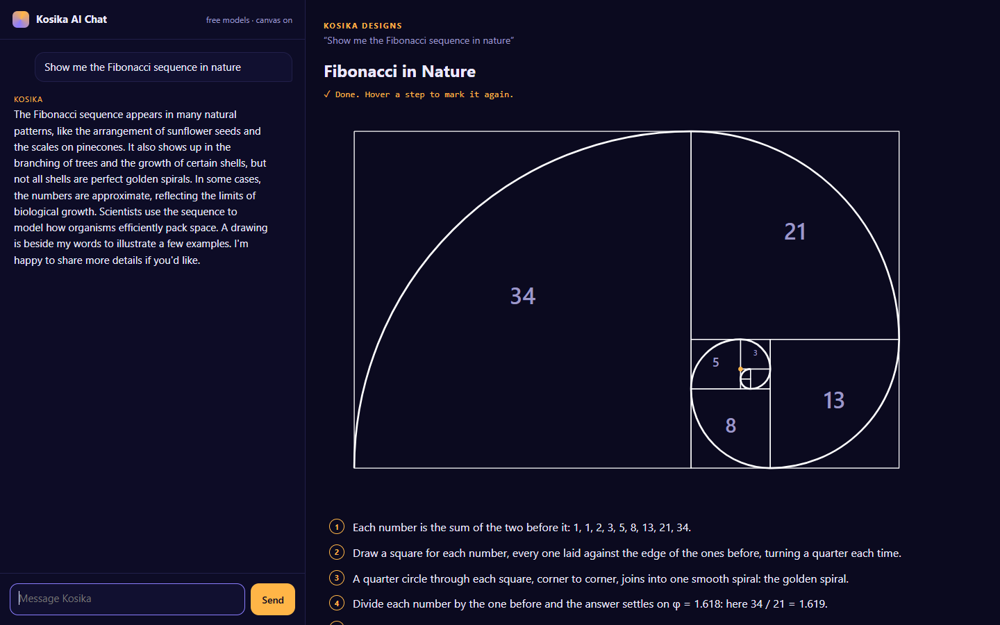
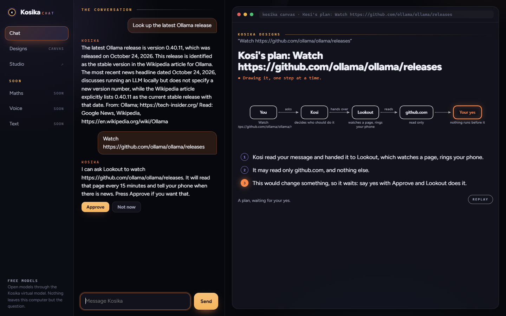

# Kosika Apps

Things you can open and use, built with the [Kosika](https://github.com/blackhole8080-darkmatter/kosika) language.

## Kosika Chat

You type a question. Kosika answers in a few short lines and draws a picture that explains it, with the hover-to-highlight drawings from [Kosika Designs](https://github.com/blackhole8080-darkmatter/kosika-designs).



Ask it about the Fibonacci sequence and you get the golden spiral next to a real sunflower:



Kosi, the assistant, lives in the same window. It can check your news, your services and your GitHub, but only the sites you've allowed, and it asks before it changes anything.



### Run it

Chat expects its two sister repos next to it, in one folder:

```text
git clone https://github.com/blackhole8080-darkmatter/kosika
git clone https://github.com/blackhole8080-darkmatter/kosika-designs
git clone https://github.com/blackhole8080-darkmatter/kosika-app
cd kosika && python -m pip install . && cd ..
python -m pip install numpy pillow scipy
python kosika-app/chat/server.py          # then open http://127.0.0.1:8793
```

It uses free models only. Set `GROQ_API_KEY` first. If your folders sit somewhere else, point `KOSIKA_HOME` and `KOSIKA_DESIGNS_HOME` at them.

## MayaOS

`mayaos/maya.kos` is the mind of MayaOS, an AI layer over the computer. It decides what to greet you with, what needs your attention and which Kosika app to open. The window that shows it is part of Kosika Studio in the main repo.

```text
kosika test mayaos/maya.kos
```

## Licence

MIT, like the rest of Kosika.
